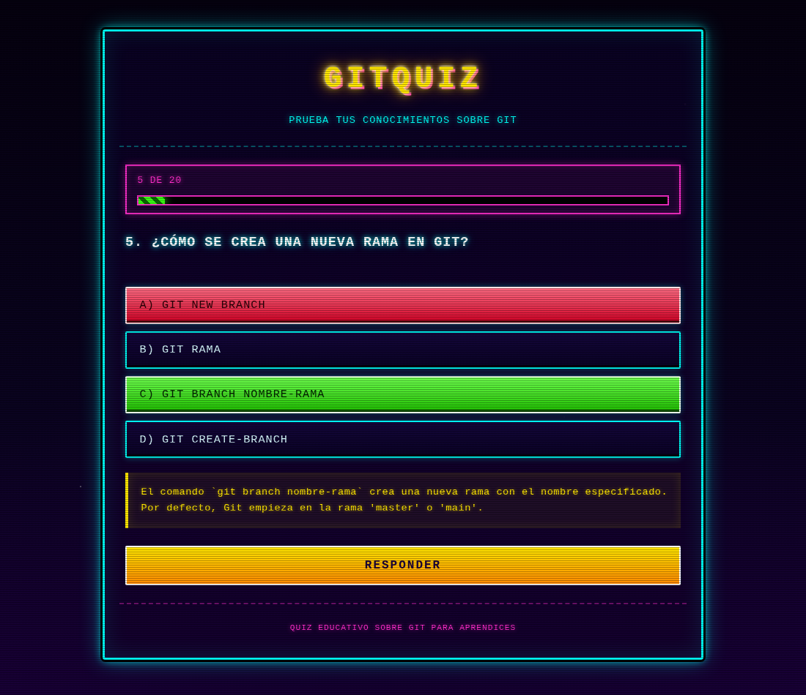
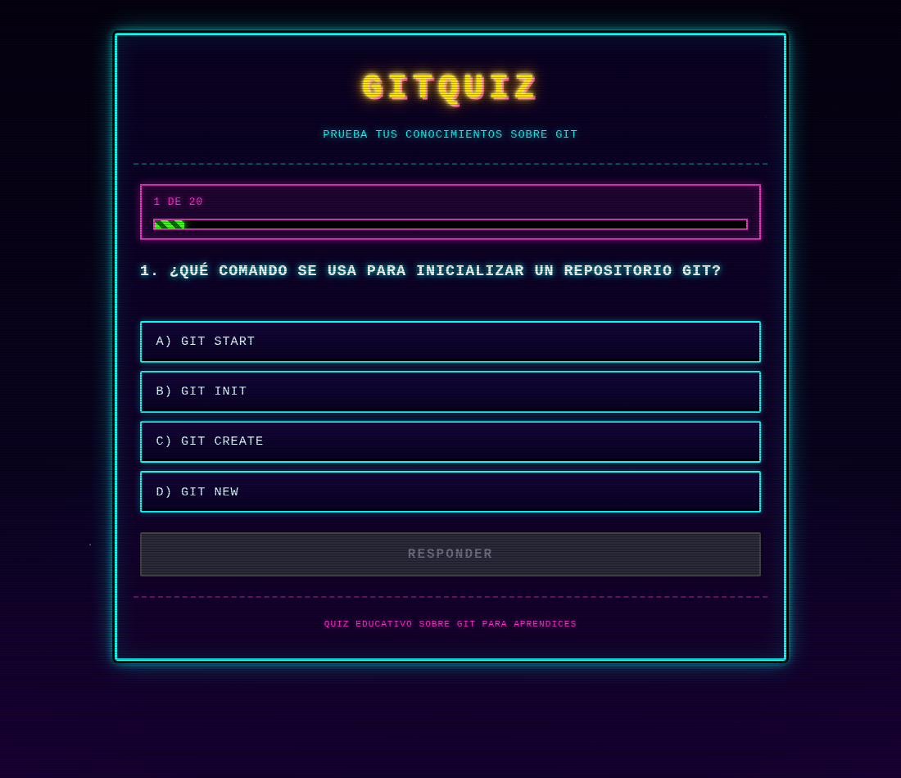
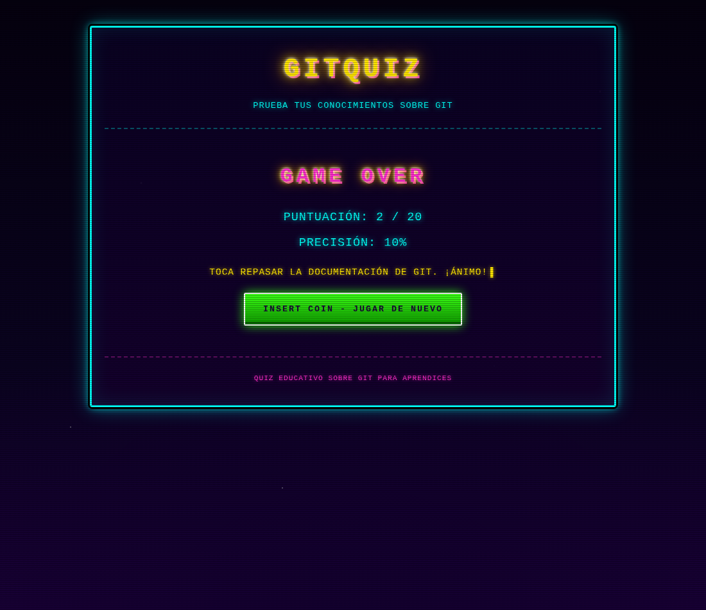
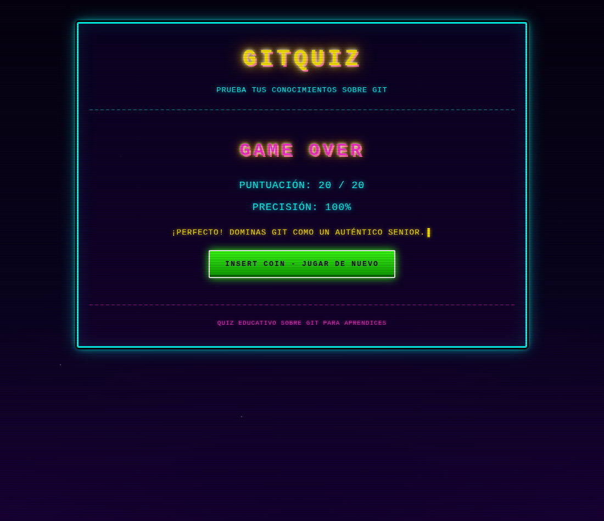

# 🎮 GitQuiz

**GitQuiz** es un quiz interactivo de **Git para principiantes** que se ejecuta
íntegramente en el navegador. Una pregunta cada vez, cuatro opciones, corrección
inmediata con explicación y una estética **retro arcade de los 80**.



## ✨ Características

- **20 preguntas** sobre Git (ramas, commits, remotos, conflictos, tags…).
- **Una pregunta cada vez** con **barra de progreso**.
- **4 opciones** por pregunta, solo una correcta.
- Al responder:
  - la opción **correcta** se marca en **verde**;
  - si fallas, tu opción se marca en **rojo**;
  - se muestra una **explicación** de la respuesta correcta.
- **Pantalla final** con puntuación, precisión y mensaje según el resultado.
- Botón para **volver a empezar**.
- Diseño **retro arcade 1980**: neones, fondo estrellado, scanlines CRT y animaciones.
- **Accesibilidad**: botones reales, estados `:disabled`, foco visible y
  `prefers-reduced-motion`.

## 🕹️ Cómo jugar

1. Se muestra la primera pregunta.
2. Pulsa una de las cuatro opciones.
3. Verás al instante la respuesta correcta en verde, tu fallo en rojo (si lo hay)
   y la explicación.
4. Pulsa **Siguiente pregunta** para continuar.
5. Al terminar, consulta tu puntuación y pulsa **JUGAR DE NUEVO** si quieres repetir.

## 🚀 Ejecutar en local

No hay build ni dependencias. Solo necesitas un servidor estático:

```bash
git clone https://github.com/franmaurizpereira/Gitquiz_con_pi_ai.git
cd Gitquiz_con_pi_ai
python3 -m http.server 8080
```

Abre <http://localhost:8080> en el navegador.

> Si el puerto 8080 está ocupado: `python3 -m http.server 3000` → <http://localhost:3000>

## 🧱 Tecnologías y reglas del proyecto

- **HTML5, CSS3 y JavaScript vanilla**. Sin frameworks ni librerías externas.
- **Sin módulos ES**: los scripts clásicos se comunican por variables globales
  (`quizData`).
- **HTML5 semántico**: `<header>`, `<main>`, `<section>`, `<footer>`…
- **Botones reales** (`<button>`), nunca `<div>` o `<a>` simulándolos.
- **Código y textos comentados en español**.

## 📁 Estructura

```
.
├── index.html                  # Estructura HTML5 semántica
├── style.css                   # Tema retro arcade (neón + CRT)
├── quiz.js                     # Datos: arreglo quizData con 20 preguntas
├── app.js                      # Lógica: render, corrección, puntuación y reinicio
├── AGENTS.md                   # Guía para agentes/personas que colaboran
├── capturas/                   # Capturas para la documentación
└── .pi/                        # Recursos de Pi (extensión y config MCP)
```

Orden de carga en `index.html`:

```html
<script src="quiz.js"></script>  <!-- define quizData -->
<script src="app.js"></script>   <!-- usa quizData -->
```

## 📝 Añadir o editar preguntas

Edita el arreglo `quizData` en `quiz.js`. Cada pregunta sigue este formato:

```js
{
    pregunta: "1. ¿Qué comando inicializa un repositorio Git?",
    opciones: [
        "A) git start",
        "B) git init",
        "C) git create",
        "D) git new"
    ],
    correcta: 1, // índice (0-3) de la opción correcta
    explicacion: "git init crea un repositorio vacío en el directorio actual."
}
```

Reglas:

- `opciones` debe tener **exactamente 4** elementos.
- `correcta` es un índice entre **0 y 3**.
- `explicacion` no puede estar vacía.

## ✅ Comprobaciones rápidas

```bash
# Sintaxis de los scripts
node --check quiz.js && node --check app.js

# Validar las preguntas (4 opciones e índice correcto)
node -e "const fs=require('fs');const m={exports:{}};new Function('module','exports',fs.readFileSync('quiz.js','utf8')+'\n;module.exports=quizData;')(m,m.exports);m.exports.forEach((q,i)=>{if(q.opciones.length!==4)throw Error('P'+(i+1));if(q.correcta<0||q.correcta>3)throw Error('P'+(i+1));});console.log('OK',m.exports.length,'preguntas')"
```

## 🧪 Partidas de prueba automatizadas

Con Playwright se jugaron dos partidas completas:

| Partida | Estrategia | Resultado |
|---|---|---|
| 1 | Responder siempre la primera opción | **2 / 20** (10 %) |
| 2 | Responder siempre la correcta | **20 / 20** (100 %) |

## 📸 Capturas

| Inicio | Pregunta corregida |
|---|---|
|  |  |

| Partida con 2/20 | Partida perfecta 20/20 |
|---|---|
|  |  |

## 📄 Licencia

Proyecto con fines **educativos**. Puedes usarlo y adaptarlo libremente citando la fuente.
